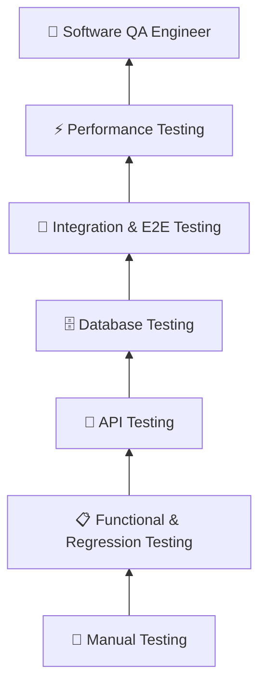

# Hi 👋, I'm Nilufar Hossain

### Software QA Engineer 🧪

 

**Test 🧪 • Discover 🐞 • Improve 🔧 • Repeat 🚀**

---

## 👩‍💻 About Me

I'm a **Software QA Engineer** with hands-on experience testing web applications, APIs, databases, and complex business workflows.

My work involves understanding requirements, designing test scenarios, executing functional and regression tests, investigating defects, validating APIs and databases, and collaborating with developers throughout the software development lifecycle.

I enjoy looking beyond the happy path and understanding **why something breaks**, not just identifying that it broke.

* 🧪 Manual, Functional & Regression Testing
* 🔌 REST API Testing with **Postman**
* 🗄️ Database Validation using **SQL**
* 🔄 Integration & End-to-End Testing
* 🐞 Defect Investigation, Reporting & Retesting
* 📋 Test Case & Test Scenario Design
* ⚡ Performance Testing with **JMeter & K6**
* 🤝 Experience working in **Agile/Scrum teams**

 

---

# 🚀 My QA Journey

### 🧪 Testing Fundamentals → 🔌 Technical Testing → 💼 Software Quality Assurance

My QA journey started with building a strong foundation in **manual software testing** — understanding requirements, designing test scenarios, executing tests, identifying defects, and documenting issues clearly.

As my experience grew, I expanded my testing beyond the user interface into **REST APIs and databases**.

### 🖥️ Frontend ↔️ 🔌 API ↔️ 🗄️ Database

Working with real-world applications has given me experience testing complex workflows, integrations, CRUD operations, regression scenarios, data behavior, and application functionality across different environments.

---

# 🎯 My Career Goal

My goal is to continue growing as a **Software QA Engineer**, deepen my technical testing knowledge, and become stronger at testing complex applications from both the user and system perspectives.

I want to continue developing my skills in **API testing, database testing, performance testing, integration testing, and software quality practices** while contributing to reliable, user-focused software.

### 🔍 Understand → 🧪 Test → 🐞 Investigate → 🔧 Improve → 🚀 Deliver

---

# 🛠️ My QA Toolbox

## 🧪 Testing

&nbsp;&nbsp;&nbsp;

  

`Postman` • `JMeter` • `K6`

---

## 💻 Programming & Technical Skills

&nbsp;&nbsp;&nbsp;

  

`Python` • `Java` • `JSON` • `REST APIs`

---

## 🗄️ Database

&nbsp;&nbsp;&nbsp;

  

`SQL` • `MySQL` • `PostgreSQL` • `DBeaver`

---

## ⚙️ Development & Collaboration

&nbsp;&nbsp;&nbsp;

&nbsp;&nbsp;&nbsp;

&nbsp;&nbsp;&nbsp;

  

`Git` • `GitHub` • `Azure DevOps` • `Jira` • `VS Code` • `Chrome DevTools`

---

# 🎯 Core QA Skills

 

### 🧪 Testing

`Manual Testing` • `Functional Testing` • `Regression Testing` • `Smoke Testing` • `Sanity Testing`

### 🔗 Technical Testing

`API Testing` • `Database Testing` • `Integration Testing` • `End-to-End Testing` • `Performance Testing`

### 🐞 Quality Assurance

`Test Case Design` • `Test Scenarios` • `Bug Reporting` • `Defect Tracking` • `Retesting` • `Exploratory Testing`

### 🔄 Process

`Agile` • `Scrum` • `SDLC` • `STLC` • `Bug Life Cycle` • `CI/CD`

---

# 📂 Featured QA Work

## 🔌 REST API Testing

Experience testing REST APIs using **Postman**, including:

`GET` • `POST` • `PUT/PATCH` • `DELETE`

* ✅ Response validation
* ✅ HTTP status-code validation
* ✅ Positive scenarios
* ❌ Negative scenarios
* 🔄 CRUD operations
* 📦 JSON request & response validation

---

## 🧪 Functional & Regression Testing

Testing real-world application workflows through:

* 📋 Requirement analysis
* 🧪 Functional testing
* 🔁 Regression testing
* 🔗 Integration testing
* 🌐 End-to-end workflow validation
* ❌ Negative and edge-case testing
* 🐞 Defect reporting and retesting

---

## 🗄️ Database Testing

SQL-based validation covering:

`CRUD Operations` • `Joins` • `Data Validation` • `Constraints` • `Data Integrity`

---

## ⚡ Performance Testing

Experience using:

### ⚡ Apache JMeter | 📈 K6

for performance testing and understanding application behavior under load.

---

# 💭 My Testing Philosophy

### 🐞 Finding a bug is only part of QA.

### 🔍 Understand → 🧪 Test → 🐞 Investigate → 🔧 Improve → 🚀 Deliver

I believe quality assurance is about understanding how a product should behave, thinking from the user's perspective, identifying risks, investigating unexpected behavior, and collaborating with the development team to deliver reliable software.

---

# 🌱 Currently Growing

---

# 🤝 Let's Connect

 

---

### 💻 Test. 🧪 Learn. 🐞 Discover. 🔧 Improve. 🚀 Repeat.

⭐ **Thanks for visiting my GitHub profile!**

