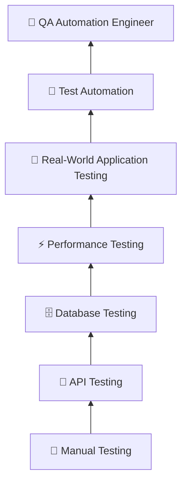

# Hi 👋, I'm Nilufar Hossain

### Software QA Engineer 🧪

 

**Test 🧪 • Discover 🐞 • Improve 🔧 • Repeat 🚀**

---

## 👩‍💻 About Me

I'm a **Software QA Engineer** with hands-on experience testing web applications, APIs, databases, and complex business workflows.

My work involves understanding requirements, designing test scenarios, executing functional and regression tests, investigating defects, validating APIs and databases, and collaborating with developers throughout the software development lifecycle.

I enjoy looking beyond the happy path and understanding **why something breaks**, not just identifying that it broke.

* 🧪 Manual, Functional & Regression Testing
* 🔌 REST API Testing with **Postman**
* 🗄️ Database Testing with **SQL & DBeaver**
* ⚡ Performance Testing with **JMeter & K6**
* 🐞 Defect Investigation, Reporting & Retesting
* 🔄 End-to-End & Integration Testing
* 🤖 Currently strengthening **Playwright & Selenium**
* 🌱 Continuously learning and improving

 

---

# 🚀 My QA Journey

### 🧪 Started with the fundamentals

### 🔍 Learned to test beyond the UI

### 💼 Applied those skills to real-world applications

### 🤖 Now growing deeper into automation

My QA journey started with **manual software testing**, where I built a strong foundation in understanding requirements, designing test scenarios, executing tests, and reporting defects clearly.

As my experience grew, I expanded into **API testing, database validation, and performance testing**, allowing me to understand applications beyond the user interface.

### 🖥️ Frontend ↔️ 🔌 API ↔️ 🗄️ Database

Working with real-world applications has also given me experience testing complex workflows, integrations, CRUD operations, regression scenarios, and application behavior across different environments.

Today, I'm continuing that journey by strengthening my **test automation** skills.

---

# 🎯 My Career Goal

My career goal is to continue growing as a **Software QA Engineer** while developing stronger expertise in **test automation**.

I want to combine my practical QA experience with automation to build reliable, maintainable, and effective testing solutions.

### 🧪 Strong QA Foundation → 🤖 Automation → 🚀 Better Software Quality

---

# 🛠️ My QA Toolbox

## 🧪 Testing & Automation

&nbsp;&nbsp;&nbsp;

&nbsp;&nbsp;&nbsp;

&nbsp;&nbsp;&nbsp;

`Playwright` • `Selenium` • `Postman` • `JMeter` • `K6`

---

## 💻 Programming

&nbsp;&nbsp;&nbsp;

&nbsp;&nbsp;&nbsp;

`JavaScript` • `Python` • `Java`

---

## 🗄️ Database

&nbsp;&nbsp;&nbsp;

`SQL` • `MySQL` • `PostgreSQL` • `DBeaver`

---

## ⚙️ Development & Collaboration

&nbsp;&nbsp;&nbsp;

&nbsp;&nbsp;&nbsp;

&nbsp;&nbsp;&nbsp;

`Git` • `GitHub` • `Azure DevOps` • `Jira` • `VS Code` • `Chrome DevTools`

---

# 🎯 Core QA Skills

 

### 🧪 Testing

`Manual Testing` • `Functional Testing` • `Regression Testing` • `Integration Testing` • `End-to-End Testing`

### 🔌 Technical Testing

`API Testing` • `Database Testing` • `Performance Testing` • `Test Automation`

### 🐞 Quality Assurance

`Test Case Design` • `Test Scenarios` • `Bug Reporting` • `Defect Tracking` • `Retesting`

### 🔄 Process

`Agile` • `Scrum` • `SDLC` • `STLC` • `CI/CD`

---

# 📂 Featured QA Projects

## 🎭 Playwright E2E Automation

> 🚧 **Currently Building**

End-to-end test automation covering real-world user workflows, positive and negative scenarios, UI validations, and regression testing.

`Playwright` • `JavaScript` • `E2E Testing` • `Automation`

---

## 🔌 REST API Testing

REST API testing covering:

### GET → POST → PUT/PATCH → DELETE

Including:

* ✅ Response validation
* ✅ HTTP status-code validation
* ✅ Positive scenarios
* ❌ Negative scenarios
* 🔄 CRUD operations
* 🤖 Automated Postman tests

---

## 🧪 Manual Testing Portfolio

Practical QA documentation including:

📋 **Test Plans**

📝 **Test Scenarios & Test Cases**

🐞 **Bug Reports**

🔁 **Regression Testing**

📊 **Test Summary Reports**

---

## ⚡ Performance Testing

Performance and load-testing examples using:

### ⚡ Apache JMeter | 📈 K6

---

## 🗄️ Database Testing

SQL-based database testing covering:

`CRUD Operations` • `Joins` • `Constraints` • `Data Validation` • `Data Integrity`

---

# 📊 GitHub Activity

# 🌱 Currently Improving

---

# 💭 My Testing Philosophy

### 🐞 Finding a bug is just the beginning.

### 🔍 Understand → 🧪 Test → 🐞 Discover → 🔧 Improve → 🚀 Deliver

I believe good QA means understanding the product, thinking from the user's perspective, identifying risks, investigating unexpected behavior, and collaborating with developers to deliver reliable software.

---

# 🤝 Let's Connect

 

---

### 💻 Test. 🧪 Learn. 🐞 Discover. 🔧 Improve. 🚀 Repeat.

⭐ **Thanks for visiting my GitHub profile!**

